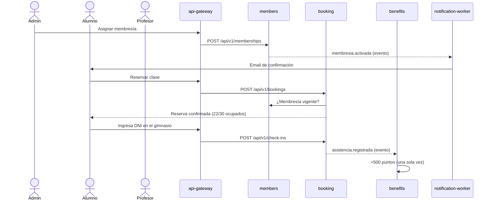

# METALFITNESS

Trabajo Práctico Integrador de **Arquitectura de Software**: METALFITNESS es un sistema de microservicios para gestionar alumnos, membresías, clases y reservas, asistencia, entrenamiento, nutrición y un **Club de Beneficios** con puntos que también usan sistemas de otros grupos.

> **Estado actual (09/11/2026):**
>
> - **Club de Beneficios** (benefits-service, Hexagonal + PostgreSQL): API pública v2 para otros grupos con registro o vinculación de personas, acreditación de puntos idempotente por evento, saldo y movimientos, con permisos y límites por integración.
> - **Identidad y membresías** (members-service, Capas + PostgreSQL): activación de cuenta por correo, login con JWT, roles y membresías mensual, trimestral, anual y por clases con historial.
> - **Gateway**: único punto de entrada; valida el JWT, aplica permisos por rol, enruta y propaga la correlación.
> - **Publicado en** <https://metalfitness-club.vercel.app> (API de partners en `/partner-api/v2`).
> - **Pendiente**: mensajería con RabbitMQ y DLQ, clases y reservas (booking), entrenamiento y nutrición (training), búsqueda, caché, balanceo, tableros y el consumo de la capacidad de otro grupo.
>
> El flujo principal y las tablas siguientes describen el **diseño objetivo**; el estado detallado de cada parte está en [Estado de implementación](#estado-de-implementación) y en [docs/ARCHITECTURE.md](docs/ARCHITECTURE.md).

## Dominio

| Actor | Qué hace |
|---|---|
| **Administrador** | Gestiona alumnos, profesionales, membresías, actividades, clases, horarios y beneficios. |
| **Profesor** | Consulta sus clases y alumnos y arma planes de entrenamiento. La asistencia se registra automáticamente al ingresar con DNI. |
| **Nutricionista** | Carga planes alimenticios, registra mediciones y responde consultas de sus pacientes. |
| **Alumno** | Reserva clases y consulta su membresía, planes, mediciones y puntos. |

Actividades: **Musculación** (7 turnos diarios de 2 horas entre 08:00 y 22:00, dentro del horario de apertura 08:00–23:00, hasta 50 alumnos) y **Funcional, GAP, Strong Nation y Zumba** (horarios configurables, hasta 30 alumnos). Cada clase asistida suma **500 puntos** en el diseño objetivo. Las reservas se pueden cancelar hasta **1 hora antes** del inicio.

El Club de Beneficios prepara una API pública para integraciones externas: registro o vinculación de personas, acreditación de puntos, saldo y movimientos. Los sistemas de otros grupos se autentican con API key; las cuentas existentes se vinculan tras verificar el control del correo. Una persona puede tener puntos sin membresía. La API está publicada en `https://metalfitness-club.vercel.app/partner-api/v2`; la guía para integrarla está en [docs/contracts/README.md](docs/contracts/README.md).

## Objetivo

Diseñar y construir un sistema distribuido que muestre, sobre un dominio concreto, decisiones de arquitectura justificadas: límites de servicios por capacidad de negocio, base de datos por servicio, patrones internos (capas y hexagonal), CQRS de lectura, mensajería con outbox, idempotencia, balanceo, observabilidad y una API publicada para terceros.

## Flujo principal



El detalle completo, con criterios de aceptación, está en [SPEC.md §11](SPEC.md#11-criterios-de-aceptación-del-flujo-principal-de-punta-a-punta).

## Arquitectura objetivo en una tabla

| Componente | Responsabilidad | Datos | Patrón | Puerto |
|---|---|---|---|---|
| `web` | SPA para todos los actores | — | React + Vite + TS | 5173 |
| `api-gateway` | Entrada única: JWT, rate limit, routing | Redis | Middlewares | 8080 |
| `members-service` | Usuarios, login, roles, membresías | PostgreSQL `members_db` | Capas | 8081 |
| `booking-service` (+ `booking-indexer`) | Actividades, clases, reservas, asistencia | PostgreSQL `booking_db` + OpenSearch | Hexagonal + CQRS | 8082 (indexer 8086) |
| `benefits-service` | Club de Beneficios y API v1 para partners | PostgreSQL `benefits_db` | Hexagonal | 8083 |
| `training-service` | Planes, mediciones, consultas | MongoDB `training_db` | Capas | 8084 |
| `notification-worker` | Emails de confirmación y vencimiento de membresía | MongoDB `notifications_db` | Consumidor | 8085 |

Más detalle en [docs/ARCHITECTURE.md](docs/ARCHITECTURE.md).

### Estado de implementación

| Estado | Alcance |
|---|---|
| **Implementado** | Módulos y ejecutables iniciales; health checks y readiness contra PostgreSQL/MongoDB; gateway con routing, correlación, CORS, timeouts y estado agregado; frontend de estado; contrato OpenAPI, guía y mock de partners. |
| **Implementado en Benefits** | API v2 para partners: registro o vinculación externa, créditos con identidad de evento, saldo y movimientos; permisos, límites y cuota por integración; PostgreSQL con migraciones, restricciones, idempotencia durable y pruebas de concurrencia. Ver [persistencia](docs/entrega-2/ETAPA_2_BENEFITS.md), [API](docs/entrega-2/ETAPA_3_API_BENEFITS.md) y [CB-02](docs/CB02_VALIDACION.md). |
| **Implementado en Members** | Activación por correo, login con JWT RS256, roles y membresías con historial, idempotencia y vencimiento según el tipo (D-77). Ver [CB-03](docs/CB03_VALIDACION.md), [API de acceso](docs/api/auth.v1.md) y [API de membresías](docs/api/memberships.v1.md). |
| **Publicado en la nube** | Gateway, Benefits, Members y web en Vercel con PostgreSQL gestionado ([ADR-021](docs/adr/ADR-021-despliegue-vercel.md), [guía](docs/deploy/VERCEL_CLUB.md)). |
| **Resiliencia validada** | Caída controlada y recuperación idempotente ante 502/503/504, incluida respuesta perdida después de commit. [Reproducción](docs/entrega-2/ETAPA_6_RESILIENCIA.md) y [postmortem](docs/POSTMORTEM.md). |
| **Observabilidad del flujo mínimo** | Logs JSON correlacionados y traza Gateway → Benefits → PostgreSQL; Collector y Jaeger local en memoria. [Evidencia y reproducción](docs/entrega-2/ETAPA_4_OBSERVABILIDAD.md). |
| **Capacidad y costos medidos** | Matriz k6 y experimento sobre cuenta compartida, sin errores funcionales ni inconsistencias; límites locales y comparación de costos USD/ARS. [Resultados y reproducción](docs/entrega-2/ETAPA_7_CAPACIDAD_COSTOS.md). |
| **Desplegado como infraestructura, todavía sin uso funcional** | Redis y RabbitMQ. |
| **Pendiente** | Mensajería RabbitMQ con DLQ y notification-worker; clases, reservas y kiosco (booking); entrenamiento y nutrición (training); alumnos con DNI, profesionales y asignaciones; recompensas y panel administrativo; caché, OpenSearch y balanceo de Booking; métricas y tableros; consumo de la capacidad de otro grupo (D9). Débitos, catálogo y canjes fueron descartados (D-76). |

## Cómo ejecutarlo localmente

### Requisitos previos

| Herramienta | Para qué | Versión |
|---|---|---|
| Docker + Docker Compose v2 | Levantar el stack | Docker Desktop reciente (Compose ≥ 2.20) |
| GNU Make | Atajos `make up`, `make test`… | 4.x — en Windows: `winget install ezwinports.make`, y ejecutá `make` desde **Git Bash** o WSL |
| Go | Tests y lint fuera de contenedores | 1.22 o superior |
| Node.js | Solo para desarrollar el frontend fuera de Docker | 20 |

Recursos: ~4 GB de RAM y **unos 6 GB libres en disco** para imágenes y builds del stack actual (crecerá con OpenSearch y la observabilidad).

### Levantar todo

```bash
cp .env.example .env && make up
```

`make up` construye las imágenes y levanta los contenedores; espera los health checks declarados. Collector y Jaeger se comprueban mediante la demostración de trazas. Después:

- Abrí **http://localhost:5173/#/estado**: la pantalla "Estado del sistema" debe mostrar todos los servicios en **Listo**. La portada (`http://localhost:5173`) lleva al ingreso.
- O consultá el gateway: `curl http://localhost:8080/api/v1/status` → `"status": "ready"`.

Sin `make`: `docker compose --env-file .env -f deploy/docker-compose.yml up -d --build --wait`.

### Otros comandos

| Comando | Qué hace |
|---|---|
| `make down` | Baja el stack (conserva los datos) |
| `make clean` | Baja el stack y borra los volúmenes |
| `make logs s=api-gateway` | Logs en vivo (sin `s=`, de todos) |
| `make ps` | Estado de los contenedores |
| `make test` | Tests de todos los módulos Go (los de integración usan Docker con testcontainers) |
| `make lint` | `go vet`, `golangci-lint` y chequeo de tipos del frontend |
| `make fmt` | Formatea el código Go |
| `make help` | Lista todos los comandos |

### URLs de cada componente

| URL | Componente |
|---|---|
| http://localhost:5173 | Frontend: ingreso y aplicación por rol; estado del sistema en `#/estado` |
| http://localhost:8080 | api-gateway — único punto de entrada |
| http://localhost:8080/api/v1/status | Estado agregado de todos los servicios |
| http://localhost:4010 | Mock de la API de partners (Prism) |
| http://localhost:16686 | Jaeger local; historial volátil en memoria |
| http://localhost:8025 | Mailpit (correos de activación); solo con el perfil `identity` |
| https://metalfitness-club.vercel.app | Despliegue público (frontend, `/api/v1` y `/partner-api/v2`) |
| http://localhost:15672 | RabbitMQ management (usuario y contraseña en `.env`) |
| http://127.0.0.1:8081/health/ready | members-service (acceso directo solo para depurar; no prueba autenticación) |
| http://127.0.0.1:8082/health/ready | booking-service |
| http://127.0.0.1:8083/health/ready | benefits-service |
| http://127.0.0.1:8084/health/ready | training-service |
| http://127.0.0.1:8085/health/ready | notification-worker |
| http://127.0.0.1:8086/health/ready | booking-indexer |
| `127.0.0.1:5432` / `127.0.0.1:27017` / `127.0.0.1:6379` | PostgreSQL / MongoDB / Redis (credenciales en `.env`) |

Collector y Jaeger ya participan en el flujo mínimo; Mailpit, con el perfil `identity`. Grafana, Traefik y OpenSearch se suman en las etapas que los usan.

Identidad y registro externo vienen apagados por defecto (`MEMBERS_IDENTITY_ENABLED` y `BENEFITS_EXTERNAL_REGISTRATION_ENABLED`). Para probarlos localmente, con claves y correo de prueba, seguí [docs/CLUB_REGISTRO_EXTERNO.md](docs/CLUB_REGISTRO_EXTERNO.md) o ejecutá el E2E aislado `go run ./tests/e2e/identity/main.go -memberships`, que levanta sus propias bases y Mailpit sin tocar tu `.env`.

## Mock de la API de partners (disponible ya)

El contrato operativo del Club de Beneficios ([docs/contracts/benefits-api.v2.yaml](docs/contracts/benefits-api.v2.yaml)) cubre registro externo, acreditación, saldo y movimientos. Se puede probar localmente con un mock (Prism) o contra la URL pública `https://metalfitness-club.vercel.app/partner-api/v2` con una API key asignada. El contrato v1 se conserva como historial.

```bash
docker compose -f deploy/docker-compose.mock.yml up -d     # o: make mock-up   → http://localhost:4010
docker compose -f deploy/docker-compose.mock.yml down      # o: make mock-down
```

Prueba rápida:

```bash
curl -s http://localhost:4010/v2/accounts/cli-10045/balance -H "X-API-Key: demo-partner-key"
```

Validar el contrato con Spectral: `make contract-lint` (o el comando `docker run` equivalente). Ejemplos completos, errores y reintentos en la [guía de integración](docs/contracts/README.md).

## Documentación

| Documento | Contenido |
|---|---|
| [SPEC.md](SPEC.md) | Especificación funcional aprobada: HU, reglas de negocio, estados, casos límite |
| [docs/ARCHITECTURE.md](docs/ARCHITECTURE.md) | Arquitectura: C4, servicios, comunicaciones, eventos, despliegue, limitaciones |
| [docs/adr/](docs/adr/) | Registros de decisiones de arquitectura (ADR) |
| [docs/contracts/](docs/contracts/README.md) | **Contrato operativo v2** del Club de Beneficios para otros grupos: [benefits-api.v2.yaml](docs/contracts/benefits-api.v2.yaml) (OpenAPI 3.1), guía de integración y mock |
| [docs/api/](docs/api/) | APIs propias del gimnasio: [acceso](docs/api/auth.v1.md) y [membresías](docs/api/memberships.v1.md) |
| [docs/deploy/VERCEL_CLUB.md](docs/deploy/VERCEL_CLUB.md) | Cómo se publica y se actualiza el despliegue en Vercel |
| [docs/DECISIONES.md](docs/DECISIONES.md) | Registro de decisiones del grupo en texto (D-01 en adelante) |
| [docs/PLAN_CLUB_BENEFICIOS.md](docs/PLAN_CLUB_BENEFICIOS.md) | Plan y estado de la ampliación del Club (CB-01 a CB-08) |
| [docs/entrega-2/VALIDACION_ENTREGA_2.md](docs/entrega-2/VALIDACION_ENTREGA_2.md) | Validación reproducible de tests, contrato, stack, flujo principal, observabilidad y resiliencia de la Entrega 2 |
| [docs/entrega-2/Guía_Entrega2.md](docs/entrega-2/Guía_Entrega2.md) | Preparación y recorrido sugerido para demostrar la Entrega 2 sin reemplazar las evidencias versionadas |
| [Registro_de_Decisiones_Gimnasio.docx](Registro_de_Decisiones_Gimnasio.docx) | Registro de decisiones del grupo (D-01 en adelante) |
| [docs/ETAPA_8_REVISION_ENTREGA.md](docs/ETAPA_8_REVISION_ENTREGA.md) | Revisión de requisitos, decisiones, evidencia y pendientes de Entrega 2 |
| [CONTRIBUTING.md](CONTRIBUTING.md) | Ramas, commits, PR y revisión |
| [CLAUDE.md](CLAUDE.md) | Contexto y reglas para asistentes de IA en este repo |

## Equipo

| Apellido | Nombre | Clave UCC |
|---|---|---|
| Pastore | Martina | 2416245 |
| Schaffer | Matías | 2434073 |
| Viti | María Guadalupe | 2426038 |

Observabilidad del flujo mínimo: [etapa 4](docs/entrega-2/ETAPA_4_OBSERVABILIDAD.md), con logs correlacionados y primera traza Gateway → Benefits → PostgreSQL. Jaeger local: http://localhost:16686; historial en memoria y evidencia exportada.

Diseño web futuro: [brief revisado](docs/diseno/BRIEF_WEB_METAL_FITNESS_V2.md),
[storyboard](docs/diseno/storyboard-entrada-metal-fitness.svg) y
[etapas FD-01–05](docs/PLAN_DISENO_FRONTEND.md). Documentación preparada;
implementación y validación visual pendientes (D-71/D-72, ADR-019 propuesto).
