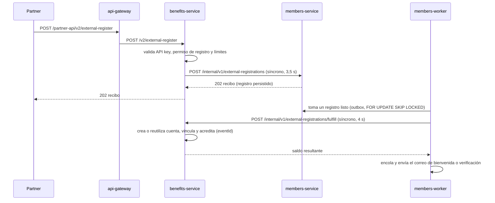

# ADR-022 — Llamadas cruzadas entre Benefits y Members en el registro externo

| Campo | Valor |
|---|---|
| **Estado** | Propuesto: documenta el diseño implementado en CB-03; requiere revisión del equipo |
| **Fecha** | 2026-11-09 |
| **Decisión del TP** | D1 (límites y relaciones) y D5 (comunicación) — precisión del diseño vigente |
| **Relacionado con** | [ADR-001](ADR-001-limites-de-servicios.md), [ADR-005 v2](ADR-005-v2-comunicacion.md), [ADR-016](ADR-016-politicas-eventos-integraciones.md), [ADR-017](ADR-017-registro-identidad-activacion.md), [ADR-021](ADR-021-despliegue-vercel.md); HU-CB-01/02 |

## Contexto

El registro externo (HU-CB-01) involucra a dos dueños de datos: Members administra
personas, identidades externas, correo y activación; Benefits administra partners,
cuentas, vinculaciones y el ledger. El flujo implementado en CB-03 los comunica en
los dos sentidos, algo que ADR-001 y ADR-005 v2 no describían:

Ambas llamadas internas usan `X-Internal-Service-Key` y se rechazan sin ella; el
gateway responde 404 a cualquier ruta `internal`. Ningún servicio lee la base del
otro (regla 3).

## Por qué se aceptó el ciclo

- **Benefits → Members, síncrono.** El partner necesita un recibo durable: la
  persona y el evento quedan persistidos antes de responder 202. Si Members no
  responde, Benefits devuelve 503 y el partner reintenta con la misma clave.
- **Members → Benefits, desde el worker.** Completar el registro acredita puntos.
  Se hace fuera de la petición del partner y se reintenta hasta confirmar, con
  identidad de evento duradera en Benefits (ADR-016): una reentrega no duplica.

## Alternativas

| Alternativa | Ventaja | Desventaja |
|---|---|---|
| Llamadas síncronas en ambos sentidos (actual) | Implementado y probado con PostgreSQL y SMTP reales; no requiere broker | Acopla la disponibilidad de los dos servicios; Vercel no admite el ciclo y obliga a desplegar una segunda instancia de Members (`members-registration`) |
| Evento `registro.completado` por outbox y RabbitMQ hacia Benefits | Elimina la llamada Members → Benefits y el ciclo de despliegue; consumo idempotente según ARCHITECTURE §8 | Requiere la mensajería de la etapa 7, todavía no implementada, y RabbitMQ en la nube |
| Registro completo dentro de Benefits | Un solo servicio | Mezcla identidad y correo con el ledger; contradice ADR-001 y ADR-017 |

## Decisión propuesta

Mantener el diseño actual para la presentación y documentarlo. Cuando exista la
mensajería de la etapa 7, evaluar reemplazar la llamada Members → Benefits por un
evento consumido de forma idempotente, lo que también eliminaría
`members-registration` en Vercel.

## Consecuencias

- Una caída de Members impide nuevos registros (503), pero no créditos, saldo ni
  movimientos de cuentas ya vinculadas.
- Una caída de Benefits demora la acreditación del registro; el worker reintenta
  y el recibo informa el estado `accepted` hasta completarse.
- La segunda instancia de Members en Vercel comparte código y base; no tiene ruta
  pública ni worker (ADR-021).

## Cómo se verifica

`go run ./tests/e2e/identity/main.go` con Gateway, Benefits, Members, PostgreSQL y
Mailpit reales: alta, recuperación tras respuesta perdida, SMTP caído y reintento
sin duplicar puntos (evidencia en `docs/evidence/club/cb03-e2e.json`).
