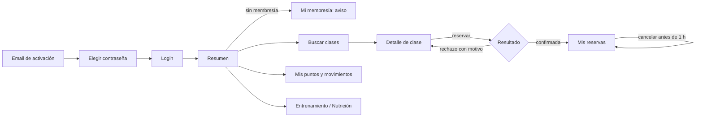
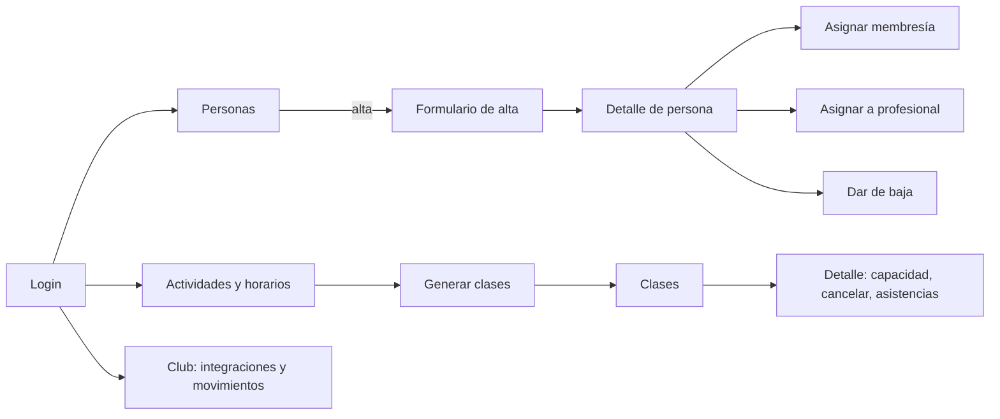
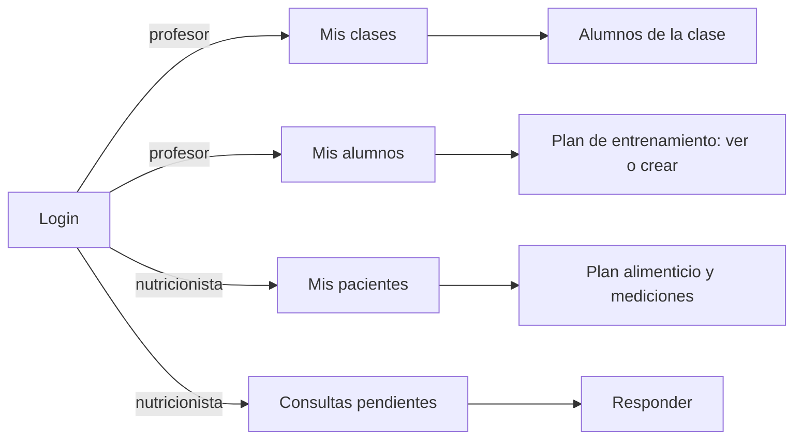
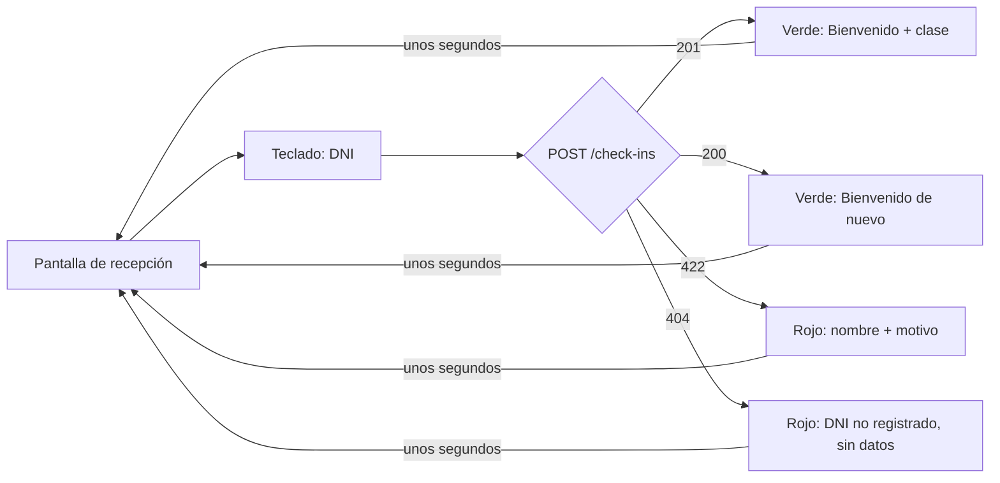

# Etapa 1 — Contratos y diseño de recorridos

Fecha: 9 de noviembre de 2026. Base: `main` en `fff9383` (PR #15). Rama:
`feature/entrega-final-etapa-01-contratos-recorridos`. Plan: [PLAN_ENTREGA_FINAL.md](PLAN_ENTREGA_FINAL.md).

**Objetivo:** que frontend y servicios no evolucionen con contratos implícitos.
**Criterio de aceptación:** cada pantalla conoce su endpoint, permisos, estados y errores.

**Entregables:**

| Entregable | Dónde |
|---|---|
| Convenciones comunes de las APIs | [docs/api/README.md](../api/README.md) |
| Contratos nuevos | [users.v1](../api/users.v1.md), [booking.v1](../api/booking.v1.md), [benefits.v1](../api/benefits.v1.md), [training.v1](../api/training.v1.md) |
| Contratos existentes, sin cambios | [auth.v1](../api/auth.v1.md), [memberships.v1](../api/memberships.v1.md), [API de partners v2](../contracts/README.md) |
| Códigos de error nuevos | [ARCHITECTURE §12.1](../ARCHITECTURE.md#121-errores--rfc-7807-applicationproblemjson) |
| Priorización, rutas, matriz, wireflows, datos y recursos | Este documento |

## 1. Historias priorizadas (confirmadas, D-81)

Criterio: **P1** es lo que exige el recorrido principal y los requisitos obligatorios de
la presentación; **P2** completa el SPEC; **fuera** quedó descartado por el equipo.

| Prioridad | Historias | Etapa del plan |
|---|---|---|
| P1 — Ya implementado | HU-03, HU-04, HU-05, HU-12, HU-27 (membresías); HU-29, HU-32, HU-CB-01 (partners) | — |
| P1 | HU-01, HU-02 (alumnos, profesionales y asignaciones) | 3 |
| P1 | HU-07 (clases generadas desde los horarios iniciales), HU-13, HU-14, HU-15, HU-16, HU-22 | 4 |
| P1 | HU-28 (email de confirmación por evento con DLQ) | 5 |
| P1 | HU-26 y HU-19 (puntos por asistencia, saldo y movimientos) | 6 |
| P2 | HU-06, HU-08, HU-21, HU-35 | 4 |
| P2 | HU-36 (avisos de vencimiento) | 5 |
| P2 | HU-10 (pantalla de integraciones) y HU-11 (reversión) | 7 |
| P2 | HU-17, HU-18, HU-23, HU-24, HU-25, HU-33, HU-34 | 10 |
| Fuera (D-76) | HU-09, HU-20, HU-30, HU-31 (catálogo, canjes y débitos) | — |

## 2. Rutas del frontend

La aplicación es una SPA servida en el mismo dominio que el gateway. El enlace de
activación actual (`/#activate=<token>`) se conserva. Las rutas llevan `#` adelante
(`#/app/clases`) por el ruteo por hash (D-80). La tabla refleja lo implementado hasta
la etapa 4; las rutas de etapas futuras son el diseño acordado.

| Área | Ruta | Pantalla | Rol |
|---|---|---|---|
| Pública | `/` | Inicio institucional | Todos |
| Pública | `/login` | Login | Todos |
| Pública | `/#activate=…` | Elegir contraseña o confirmar vinculación | Persona con enlace |
| Administración | `/recepcion` | Pantalla de ingreso por DNI | ADMINISTRADOR (D-82) |
| Alumno | `/app` | Resumen: membresía, próximas reservas y saldo | ALUMNO |
| Alumno | `/app/clases` | Búsqueda con ocupación; reservar desde el listado (etapa 4) | ALUMNO |
| Alumno | `/app/reservas` | Mis reservas e historial; cancelar | ALUMNO |
| Alumno | `/app/membresia` | Mi membresía e historial | ALUMNO |
| Alumno | `/app/puntos` | Saldo y movimientos | ALUMNO |
| Alumno | `/app/entrenamiento` | Mi plan de entrenamiento | ALUMNO |
| Alumno | `/app/nutricion` | Plan alimenticio, mediciones y consultas | ALUMNO |
| Común | `/cuenta` | Mi cuenta; el cierre de sesión está en la barra superior (etapa 2) | Todos los roles |
| Administrador | `/admin/personas` y `/admin/personas/:id` | Alumnos y profesionales; membresías y asignaciones de la persona | ADMINISTRADOR |
| Administrador | `/admin/actividades` | Actividades y horarios; generar clases | ADMINISTRADOR |
| Administrador | `/admin/clases` y `/admin/clases/:id` | Clases, capacidad, cancelación y asistencias | ADMINISTRADOR |
| Administrador | `/admin/club` | Integraciones y movimientos de una persona | ADMINISTRADOR |
| Pública | `/estado` | Estado del sistema (pantalla actual); pública como `/api/v1/status`, ver [etapa 2](ETAPA_2_IDENTIDAD.md) | Todos |
| Profesor | `/prof/clases` y `/prof/clases/:id` | Mis clases y sus alumnos | PROFESOR |
| Profesor | `/prof` | Mis alumnos asignados (etapa 3); el plan de entrenamiento se suma en la etapa 10 | PROFESOR |
| Nutricionista | `/nutri` | Mis pacientes (etapa 3); plan alimenticio y mediciones en la etapa 10 | NUTRICIONISTA |
| Nutricionista | `/nutri/consultas` | Consultas pendientes y respuestas | NUTRICIONISTA |

Tras el login, cada rol entra a su inicio: `/app`, `/admin/personas`, `/prof` o
`/nutri`. Una ruta de otro rol muestra "acceso denegado"; el backend vuelve a
verificar siempre (RN-30). El JWT vive solo en memoria y un 401 lleva al login (auth.v1).

El gateway deja pasar a los roles no administradores solo por sus rutas propias: cuenta,
saldo y membresía (etapa 2), "mis alumnos" (etapa 3) y las rutas de booking de cada rol
(etapa 4, `bookingAllowed`). Cada etapa que implemente un contrato amplía esa matriz en
`gateway/internal/proxy/access.go` según la columna "Quién".

## 3. Matriz pantalla → endpoint → permisos → estados → errores

Estados comunes a todas las pantallas: **cargando**, **error** (con `correlation_id`) y
**sin permiso**. La tabla agrega los estados y errores propios.

| Pantalla | Endpoints | Permiso | Estados propios | Errores que muestra |
|---|---|---|---|---|
| Login | POST /auth/login | Público | Credenciales inválidas | 401 genérico, 429 |
| Activar cuenta | POST /auth/activate, POST /auth/resend-activation | Enlace | Enlace usado o vencido; reenviado | 400, 401 |
| Mi cuenta | GET /users/me, POST /auth/logout | Todos | — | 401 |
| Resumen del alumno | GET /memberships/me, GET /bookings/me, GET /benefits/me | ALUMNO | Sin membresía vigente (aviso de que no puede reservar, CA-12.2) | 404 `CUENTA_NO_ENCONTRADA` |
| Búsqueda de clases | GET /classes, GET /activities | ALUMNO | Sin resultados; completa; ya reservada | 400 en filtros |
| Reserva (desde la búsqueda; sin detalle propio en la etapa 4) | POST /bookings | ALUMNO | Reservando (sin doble envío); reservada | `MEMBRESIA_NO_VIGENTE`, `SIN_CUPO`, `RESERVA_DUPLICADA`, `TURNO_MUSCULACION_DIARIO`, `SUPERPOSICION_RESERVA`, `CLASE_NO_FUTURA`, 503 |
| Mis reservas | GET /bookings/me, POST /bookings/{id}/cancel | ALUMNO | Vacío; ya cancelada | `PLAZO_CANCELACION_VENCIDO` |
| Mi membresía | GET /memberships/me | ALUMNO | Sin membresías; vencida; programada | — |
| Mis puntos | GET /benefits/me, GET /benefits/me/movements | ALUMNO | Sin movimientos; cuenta en creación | 404 `CUENTA_NO_ENCONTRADA` |
| Entrenamiento | GET /training/plans/me | ALUMNO | Sin plan (CA-17.2) | 404 |
| Nutrición | GET /nutrition/plans/me, GET y POST /nutrition/questions… | ALUMNO | Sin plan; consulta pendiente o respondida | `SIN_NUTRICIONISTA` |
| Pantalla de recepción | POST /check-ins | ADMINISTRADOR | Verde "Bienvenido" / "Bienvenido de nuevo"; rojo con motivo | `MEMBRESIA_NO_VIGENTE`, `SIN_RESERVA_PARA_HORARIO`, `USUARIO_INACTIVO`, 404 sin datos |
| Personas (admin) | GET /users, POST /users, PUT /users/{id}, POST /users/{id}/deactivate | ADMINISTRADOR | Vacío; activación pendiente; inactiva | `PERSONA_DUPLICADA`, `TRANSICION_INVALIDA` |
| Detalle de persona (admin) | GET /users/{id}, GET /memberships/users/{id}, POST /memberships, renew, cancel, assignments | ADMINISTRADOR | Sin membresía; asignaciones vigentes e históricas | `MEMBRESIAS_SUPERPUESTAS`, `TRANSICION_MEMBRESIA_INVALIDA`, `ASIGNACION_DUPLICADA` |
| Actividades (admin) | GET/POST/PUT /activities, schedules, POST /classes/generate | ADMINISTRADOR | Generación sin duplicados | 400 (franja o responsable inválidos), `SUPERPOSICION_PROFESOR` |
| Clases (admin) | GET /classes, GET /classes/{id}, capacity, cancel | ADMINISTRADOR | Asistentes y ausentes | 400 capacidad, `TRANSICION_INVALIDA` |
| Club (admin) | GET/POST/PUT /benefits/partners…, GET /benefits/accounts/{id}, revert | ADMINISTRADOR | Key mostrada una sola vez | `SALDO_INSUFICIENTE`, `TRANSICION_INVALIDA` |
| Mis clases (profesor) | GET /classes/mine, GET /classes/{id} | PROFESOR | Sin clases | — |
| Mis alumnos (profesor) | GET /users/me/students, GET y POST /training/plans | PROFESOR | Sin asignados; sin plan | 403 alumno no asignado |
| Pacientes y consultas (nutricionista) | GET /users/me/students, /nutrition/plans, measurements y questions | NUTRICIONISTA | Pendientes primero; respondida | 403, `TRANSICION_INVALIDA` |

## 4. Wireflows

### Alumno

### Administrador

### Profesor y nutricionista

### Ingreso por DNI

## 5. Datos iniciales y fixtures de demostración

Todos sintéticos: nombres, DNIs y correos ficticios (`@example.test`), sin datos de
personas reales.

| Dato | Origen | Etapa |
|---|---|---|
| Administrador inicial | Variables `MEMBERS_ADMIN_EMAIL` y `MEMBERS_ADMIN_PASSWORD`, creado una sola vez | 3 |
| Tipos de membresía Mensual, Trimestral y Anual | Migración existente (D-67, D-77) | Hecho |
| 5 actividades | Seed de booking (CA-06.1) | 4 |
| Horarios fijos de grupales (D-35) y 7 franjas de Musculación (D-01) | Seed de booking | 4 |
| 2 profesores y 1 nutricionista | Script de demostración por API | 3 |
| 3 alumnos: con membresía vigente, vencida y sin membresía | Script de demostración por API | 3 |
| Asignaciones profesional–alumno | Script de demostración por API | 3 |
| Clases de la semana de la presentación | `POST /classes/generate` | 4 |
| Una clase con un solo lugar libre | Script (demostración de concurrencia, CA-14.8) | 4 |
| Integración de demostración con API key | `scripts/provision-club-partner.ps1` | Hecho |

El script de demostración se escribe al implementar la etapa 3 y se completa en la 4;
debe poder ejecutarse contra local y contra la nube sin datos reales.

## 6. Recursos visuales faltantes

No se inventan: hasta tenerlos se usan placeholders explícitos (DISENO_FRONTEND §8).

| Recurso | Estado |
|---|---|
| Logotipo oficial en formato web | Falta |
| Fotografías autorizadas del gimnasio, actividades y profesionales | Faltan |
| Dirección, horarios de atención y canales oficiales | Falta confirmar |
| Textos institucionales aprobados | Faltan |
| Iconografía de estados (reserva, membresía, movimiento) | A definir en la etapa 11 con un set libre |
| Diseño de la capacidad externa | Depende del proveedor (D9) |

## 7. Decisiones del equipo

Las siete preguntas abiertas de esta etapa se resolvieron el 09/11/2026 y están en
[DECISIONES.md](../DECISIONES.md).

| # | Pregunta | Decisión |
|---|---|---|
| 1 | Qué historias entran antes de la presentación | P1 de §1; P2 solo si queda tiempo. Orden: Booking (4), Booking → Benefits (6) y notificación (5). **D-81** |
| 2 | Credencial de la terminal de recepción (HU-22) | El ADMINISTRADOR registra el ingreso desde la pantalla de recepción; sin rol ni credencial nueva, sin ADR. `RECEPCION` queda como mejora futura. **D-82** |
| 3 | Estado de notificaciones para el administrador (CL-14) | Logs y tablero de observabilidad (etapa 14); no se agrega `/api/v1/notifications`. **D-83** |
| 4 | Rutas del frontend | Sin librería nueva: rutas `#/...` de `web/src/router.ts`. **D-80** |
| 5 | Documento de diseño de la etapa 11 | Manda [DISENO_FRONTEND.md](DISENO_FRONTEND.md); el plan FD queda como referencia visual. **D-84** |
| 6 | Reglas del padrón | Registradas. **D-78** y **D-79** |
| 7 | Paso 8 del recorrido principal | Confirmado: saldo, movimientos y acreditación por la API v2, sin canjes. **D-85** |

## 8. Verificación del criterio de aceptación

Cada pantalla de §2 aparece en la matriz de §3 con su endpoint, su permiso, sus estados
y sus errores; cada endpoint de la matriz está definido en un contrato de `docs/api/`.
Las únicas pantallas sin contrato propio son la de la capacidad externa (depende de D9)
y la de notificaciones, que se reemplaza por logs y tablero (D-83).
