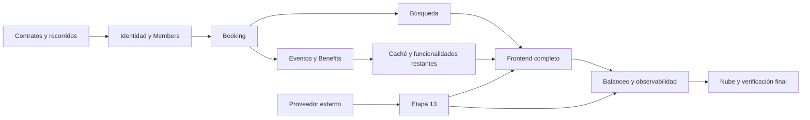

# Plan de trabajo — Entrega Final

> Estado inicial: 18/10/2026. Presentación grupal prevista para el 11 o el 13 de noviembre de 2026; la fecha de cada grupo se comunicará el 6 de noviembre.

## 1. Propósito

Este documento organiza todo el trabajo posterior a la Entrega 2 hasta la presentación final. Cada etapa debe terminar con comportamiento ejecutable, pruebas y evidencia; la documentación se actualiza durante el desarrollo.

La capacidad externa permanece bloqueada hasta recibir proveedor, contrato y credenciales. El resto del sistema puede avanzar sin inventar esa integración.

## 2. Fuentes y restricciones

1. `SPEC.md` gobierna funcionalidades, reglas, actores y permisos.
2. `docs/ARCHITECTURE.md`, ADR y contratos gobiernan arquitectura e integración.
3. `docs/entrega-final/DISENO_FRONTEND.md` gobierna solamente la estética.
4. Las herramientas ajenas al teórico se incorporan únicamente cuando son necesarias y se justifican como decisiones del proyecto.
5. Cada cambio se realiza en una rama corta y se integra por Pull Request con CI y revisión de otro integrante.

## 3. Resultado esperado

Al finalizar, el sistema debe demostrar:

- frontend completo desde autenticación hasta las capacidades propia y externa;
- gateway como punto de entrada con autenticación, autorización, routing y control de tráfico;
- tres o más servicios operativos con al menos dos patrones internos reconocibles;
- Benefits publicado en la nube mediante una URL;
- capacidad externa integrada al flujo cuando sea provista;
- PostgreSQL y al menos un almacenamiento no relacional usados por flujos reales;
- caché relevante con comparación antes/después;
- evento de dominio publicado y consumido, con outbox, idempotencia, reintentos y DLQ;
- búsqueda indexada con filtros, paginación, ordenamiento, actualización y reconstrucción;
- balanceo sobre dos instancias, detección de caída y evidencia de distribución;
- logs estructurados, métricas, tablero y trazas del flujo principal;
- pruebas unitarias, integración real, E2E, concurrencia y carga;
- decisiones D1–D13 validadas con evidencia;
- arquitectura, limitaciones y deuda técnica actualizadas.

## 4. Recorrido principal propuesto

El recorrido conductor será:

1. Un administrador registra o habilita al alumno y le asigna una membresía.
2. La membresía se persiste y produce una notificación asíncrona.
3. El alumno inicia sesión y busca una clase.
4. El alumno reserva; Booking valida identidad, membresía, superposición y cupo.
5. El alumno registra su ingreso mediante DNI.
6. Booking confirma la asistencia y publica el evento correspondiente.
7. Benefits consume el evento y acredita 500 puntos exactamente una vez.
8. El alumno consulta movimientos y realiza un canje válido.
9. La capacidad externa se incorpora en el punto que corresponda cuando sea conocida.

Este flujo conecta frontend, gateway, Members, Booking, Benefits, Notification Worker, PostgreSQL, MongoDB, RabbitMQ, OpenSearch y Redis sin convertir los requisitos en demostraciones aisladas.

## 5. Etapas

### Etapa 0 — Línea base y trazabilidad

**Estado:** Pendiente.

**Objetivo:** comenzar desde `main` estable y convertir los requisitos finales en una matriz verificable.

**Trabajo:**

- ejecutar tests, lint, build, contrato y stack limpio;
- registrar qué está implementado, diseñado o pendiente;
- mapear requisito → servicio → pantalla → prueba → decisión → evidencia;
- confirmar el flujo principal y las funcionalidades mínimas de cada rol;
- realizar una prueba temprana de compatibilidad con la VM ARM elegida.

**Aceptación:** línea base reproducible y matriz sin requisitos huérfanos.

### Etapa 1 — Contratos y diseño de recorridos

**Estado:** Pendiente.

**Objetivo:** evitar que frontend y servicios evolucionen con contratos implícitos.

**Trabajo:**

- definir endpoints necesarios por cada historia priorizada;
- completar esquemas de request, response y errores;
- definir rutas públicas y autenticadas del frontend;
- crear wireflows de alumno, administrador, profesor, nutricionista e ingreso por DNI;
- enumerar datos iniciales y fixtures para la demostración;
- registrar recursos visuales faltantes sin inventarlos.

**Aceptación:** cada pantalla conoce su endpoint, permisos, estados y errores.

### Etapa 2 — Identidad, autenticación y autorización

**Estado:** Pendiente.

**Objetivo:** disponer de ingreso real y una frontera de confianza en el gateway.

**Trabajo:**

- implementar usuarios, credenciales seguras y login;
- emitir y validar JWT con duración y claims acordados;
- eliminar cabeceras de identidad externas e inyectarlas desde el token;
- aplicar autorización fina en cada servicio;
- incorporar pantalla de login, sesión y rutas protegidas;
- probar expiración, token inválido, rol insuficiente e identidad manipulada.

**Aceptación:** ningún flujo privado opera sin identidad válida y los permisos de RN-30 se verifican en el dueño del dato.

### Etapa 3 — Members de punta a punta

**Estado:** Pendiente.

**Objetivo:** volver operativo el dueño de alumnos, profesionales, asignaciones y membresías.

**Trabajo:**

- implementar casos de uso y persistencia faltantes;
- aplicar unicidad, bajas lógicas, vigencia, renovación y no solapamiento;
- exponer consultas internas necesarias para Booking y otros servicios;
- crear pantallas administrativas y consultas del alumno;
- cubrir reglas relevantes con tests unitarios e integración PostgreSQL.

**Aceptación:** un administrador puede preparar un alumno con membresía válida y el alumno puede consultarla.

### Etapa 4 — Booking, clases y reservas

**Estado:** Pendiente.

**Objetivo:** implementar el núcleo operativo de actividades, clases, reservas e ingreso.

**Trabajo:**

- actividades, horarios, generación y cancelación de clases;
- reserva y cancelación con idempotencia;
- control atómico de cupo, duplicados, Musculación diaria y superposición;
- validación síncrona de alumno y membresía;
- ingreso por DNI, asistencia y cierre automático de clases;
- frontend de búsqueda, reservas, administración e ingreso;
- tests concurrentes y de límites temporales.

**Aceptación:** los E2E de reserva, cancelación, concurrencia, asistencia y ausencia conservan todas las invariantes.

### Etapa 5 — Mensajería y notificaciones

**Estado:** Pendiente.

**Objetivo:** demostrar comunicación asíncrona durable mediante un flujo real.

**Trabajo:**

- implementar outbox transaccional y relay con publisher confirms;
- publicar el evento de membresía asignada o renovada;
- consumirlo en Notification Worker de forma idempotente;
- persistir estado e intentos en MongoDB;
- integrar un servidor SMTP local de demostración;
- aplicar reintentos acotados y DLQ para mensajes no procesables;
- observar backlog, reintentos y mensajes fallidos.

**Aceptación:** la membresía no se revierte si falla el email, el mismo evento no crea dos efectos lógicos y un mensaje inválido termina en DLQ.

### Etapa 6 — Integración Booking → Benefits

**Estado:** Pendiente.

**Objetivo:** conectar la asistencia y las ausencias con el ledger ya validado.

**Trabajo:**

- publicar eventos de asistencia y ausencia desde Booking;
- consumirlos idempotentemente en Benefits;
- acreditar 500 puntos o aplicar la penalización permitida;
- conservar orden por cuenta y referencia única al hecho de origen;
- demostrar caída y recuperación de Benefits sin perder ni duplicar puntos;
- mostrar saldo y movimientos actualizados en el frontend.

**Aceptación:** cada hecho produce como máximo un movimiento durable y converge después de una interrupción.

### Etapa 7 — Club de Beneficios completo

**Estado:** Pendiente.

**Objetivo:** completar catálogo, canje, administración y operaciones faltantes del contrato propio.

**Trabajo:**

- catálogo y vigencia de beneficios;
- canje atómico y reversión autorizada;
- débitos y operaciones de partner todavía pendientes;
- gestión de partners y vinculaciones;
- vistas del alumno y del administrador;
- actualizar contrato propio solo si cambia la capacidad publicada.

**Aceptación:** consulta, canje y administración respetan saldo, vigencia, aislamiento e idempotencia.

### Etapa 8 — Búsqueda indexada

**Estado:** Pendiente.

**Objetivo:** buscar clases mediante OpenSearch sin usar el índice para decisiones transaccionales.

**Trabajo:**

- modelo `ClaseLectura` e índice versionado con alias;
- indexación por eventos y descarte de versiones antiguas;
- filtros, paginación y ordenamiento aprobados en D6;
- reconstrucción completa desde PostgreSQL;
- medición del retraso entre escritura e índice;
- degradación explícita si OpenSearch no está disponible.

**Aceptación:** búsqueda funcional, lag medido dentro del objetivo o documentado, y reserva revalidada siempre contra PostgreSQL.

### Etapa 9 — Caché relevante

**Estado:** Pendiente.

**Objetivo:** usar Redis en una lectura que se beneficie de forma observable.

**Trabajo:**

- elegir definitivamente el catálogo de actividades o beneficios según mediciones base;
- implementar cache-aside, TTL e invalidación por escritura;
- definir comportamiento ante caída de Redis;
- exportar hits, misses, errores y latencia;
- ejecutar comparación antes/después bajo la misma carga.

**Aceptación:** la elección está justificada por datos, la fuente de verdad permanece intacta y existen métricas comparables.

### Etapa 10 — Training, nutrición y funcionalidades restantes

**Estado:** Pendiente.

**Objetivo:** completar los recorridos definidos en `SPEC.md` que no forman parte del núcleo de reservas.

**Trabajo:**

- planes de entrenamiento;
- planes alimenticios y mediciones;
- consultas y respuestas nutricionales;
- asignaciones y autorización vigente;
- persistencia MongoDB y pruebas de integración;
- pantallas de alumno, profesor y nutricionista.

**Aceptación:** cada rol accede únicamente a sus alumnos o pacientes y los casos principales funcionan de punta a punta.

### Etapa 11 — Frontend completo y coherencia visual

**Estado:** Pendiente.

**Objetivo:** cerrar la experiencia pública y autenticada con la identidad aprobada.

**Trabajo:**

- implementar tokens, componentes y layouts de `DISENO_FRONTEND.md`;
- construir el sitio público con datos confirmados;
- completar navegación y pantallas de todos los roles;
- integrar estados de carga, error, vacío, éxito y acceso denegado;
- revisar responsive, teclado, foco, contraste y reducción de movimiento;
- optimizar recursos y mantener el frontend sin errores de tipo.

**Aceptación:** el recorrido desde login hasta la capacidad compartida puede realizarse sin llamadas manuales y las pantallas requeridas son utilizables en desktop y móvil.

> El frontend se desarrolla incrementalmente en las etapas anteriores; esta etapa realiza el cierre transversal.

### Etapa 12 — Entrada única, control de tráfico y balanceo

**Estado:** Pendiente.

**Objetivo:** completar las responsabilidades operativas del borde.

**Trabajo:**

- token bucket atómico en Redis y respuestas `429` con `Retry-After`;
- políticas diferenciadas para login, usuarios y partners;
- dos instancias de Booking detrás de Traefik;
- health checks, retiro y reincorporación según D12;
- identificar instancia en logs o métricas para comprobar distribución;
- provocar una caída y verificar continuidad.

**Aceptación:** toda entrada pública atraviesa el borde, el tráfico se distribuye y una instancia caída deja de recibir solicitudes.

### Etapa 13 — Capacidad externa y D9

**Estado:** Bloqueada por proveedor no asignado.

**Objetivo:** incorporar la capacidad de otro grupo a un flujo principal relevante.

**Trabajo cuando se reciba:**

- revisar contrato, autenticación, versionado y límites;
- decidir servicio consumidor y modelo interno;
- implementar puerto y adaptador anticorrupción;
- definir timeout, retry, errores y degradación;
- integrar el recorrido en frontend;
- crear tests contra mock contractual y proveedor real;
- completar ADR-009 y evidencias.

**Aceptación:** la capacidad real puede usarse desde el frontend y sus fallas no corrompen el estado local.

### Etapa 14 — Observabilidad y resiliencia finales

**Estado:** Pendiente.

**Objetivo:** comprender el recorrido completo sin inspeccionar manualmente cada componente.

**Trabajo:**

- extender logs y trazas a Members, Booking, RabbitMQ, Benefits y proveedor externo;
- incorporar métricas RED, de negocio, caché, outbox, colas, DLQ e índice;
- configurar Prometheus y un tablero Grafana útil para la defensa;
- validar correlación entre frontend, gateway, servicios y eventos;
- provocar fallas de Redis, RabbitMQ, OpenSearch, servicios y proveedor;
- actualizar `POSTMORTEM.md` con el ejercicio final.

**Aceptación:** una operación y una falla pueden reconstruirse mediante tablero, traza y logs correlacionados.

### Etapa 15 — Despliegue en la nube

**Estado:** Pendiente.

**Objetivo:** publicar la capacidad propia y preparar un entorno demostrable.

**Trabajo:**

- perfil Compose de producción compatible con ARM;
- Traefik como borde HTTPS y servicios en red privada;
- secretos fuera del repositorio, volúmenes y backups mínimos;
- URL pública estable para la capacidad propia;
- smoke tests y prueba contractual desde una red externa;
- registrar versión, región, recursos, costos y limitaciones reales.

**Aceptación:** un consumidor externo puede acceder mediante HTTPS a la capacidad publicada y ejecutar el ejemplo documentado.

### Etapa 16 — Verificación y presentación

**Estado:** Pendiente.

**Objetivo:** cerrar código, evidencia y relato técnico.

**Trabajo:**

- tests unitarios de reglas con cobertura interpretada, no solo porcentaje;
- integración por servicio contra dependencias reales;
- E2E del recorrido principal y casos de error;
- pruebas de carga y análisis actualizado;
- matriz final de D1–D13 con decisión y evidencia;
- actualizar README, arquitectura, ADR, contratos, limitaciones y deuda;
- preparar datos, guion, responsables y alternativa local si falla Internet;
- realizar al menos dos ensayos cronometrados.

**Aceptación:** checklist completo, CI verde, entorno reproducible y demostración ensayada.

## 6. Dependencias principales

La preparación técnica del adaptador externo puede esperar, pero su integración real condiciona el cierre del frontend, la traza principal y la documentación final.

## 7. Calendario objetivo

| Período | Objetivo |
|---|---|
| 18–20 de octubre | Línea base, contratos, recorridos y diseño |
| 21–27 de octubre | Identidad, Members, Booking y frontend asociado |
| 28 de octubre–3 de noviembre | Mensajería, Benefits, búsqueda, caché y funcionalidades restantes |
| 4–7 de noviembre | Balanceo, observabilidad, proveedor externo si está disponible y despliegue |
| 8–10 de noviembre | Validación completa, documentación y ensayos |
| 11 o 13 de noviembre | Presentación grupal |

El calendario se recalibra al conocer la fecha del grupo y la capacidad externa. La meta interna es congelar funcionalidades antes del 8 de noviembre.

## 8. Estrategia de ramas y commits

- Una rama por etapa o recorrido coherente: `feature/entrega-final-etapa-NN-nombre`.
- Commits pequeños con Conventional Commits.
- Código, migraciones, contrato, tests y evidencia del mismo comportamiento viajan en el mismo PR.
- No se declara una etapa completa por estructura o mocks: debe cumplir su criterio de aceptación.
- Cada PR actualiza este seguimiento y las decisiones afectadas.

## 9. Seguimiento inicial

| Etapa | Estado | Dependencia crítica |
|---|---|---|
| 0. Línea base | Pendiente | `main` estable |
| 1. Contratos y recorridos | Pendiente | Revisión del equipo |
| 2. Identidad | Pendiente | Members y Gateway |
| 3. Members | Pendiente | Contratos internos |
| 4. Booking | Pendiente | Members operativo |
| 5. Mensajería | Pendiente | Members y RabbitMQ |
| 6. Booking → Benefits | Pendiente | Booking y mensajería |
| 7. Benefits completo | Pendiente | Ledger existente |
| 8. Búsqueda | Pendiente | Booking y OpenSearch |
| 9. Caché | Pendiente | Flujo de lectura medido |
| 10. Training y nutrición | Pendiente | Identidad y asignaciones |
| 11. Frontend completo | Pendiente | Contratos y servicios |
| 12. Borde y balanceo | Pendiente | Booking operativo |
| 13. Capacidad externa | **Bloqueada** | Proveedor y contrato |
| 14. Observabilidad final | Pendiente | Flujos integrados |
| 15. Nube | Pendiente | Perfil ARM y secretos |
| 16. Verificación final | Pendiente | Todas las anteriores |

## 10. Riesgos que deben revisarse en cada etapa

- proveedor externo recibido demasiado tarde;
- alcance funcional mayor que el tiempo disponible;
- incompatibilidades o límites de la VM ARM gratuita;
- falta de logotipo y fotografías oficiales;
- crecimiento de recursos al incorporar OpenSearch, Prometheus, Grafana y Loki;
- contratos modificados después de comenzar el frontend;
- demostración dependiente de Internet sin alternativa local;
- documentación que describa diseño objetivo como si ya estuviera implementado.

